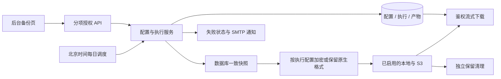

# 管理员备份管理技术设计

状态：用户于 2026-11-02 批准最新完整规划，进入实施。产品决定见 `prd.md`；来源和残余限制见 `research/findings.md`。

## 1. 边界与数据流

沿用单应用进程部署。新增实例级备份管理器和后台运行器，独立于个人 AI TaskEngine、项目归属及用户任务配额。

路由只处理鉴权、参数和响应，业务放入 `services/backups/`。新配置不加入既有六项 `SystemSettings`，也不修改公开 `/auth/config`。

## 2. 模块与责任

| 路径 | 职责 |
| --- | --- |
| `app/models/backup.py` | BackupSettings、BackupRun、BackupArtifact |
| `app/schemas/backup.py` | 配置输入/安全输出、执行和产物枚举、分页与错误码 |
| `app/services/backups/service.py` | 安全投影、配置 CAS、手动准入、真实 actor 与审计 |
| `app/services/backups/runtime.py` | 定时、全局单执行、运行状态、重启恢复与关停 |
| `app/services/backups/database.py` | PostgreSQL 工具与 SQLite backup API |
| `app/services/backups/crypto.py` | 文件 GPG 加密及私有临时目录 |
| `app/services/backups/storage.py` | 本地、S3、定位快照、下载、保留清理 |
| `app/services/backups/mail.py`、`network.py` | 安全邮件和出站策略 |
| `app/api/v1/admin_backups.py` | `/admin/backups` API，no-store |
| `frontend/src/api/adminBackups.ts`、`api/types.ts` | 唯一前端传输定义、API 和原生下载入口 |
| `frontend/src/components/adminBackups/` | 页级 controller/hook、配置表单、记录与详情 |
| `frontend/src/pages/AdminBackupsPage.tsx` | 懒加载页面，复用现有主题和响应式布局 |

模块保持本任务边界；不建立全站通用配置框架、通知平台或通用任务编排器。

## 3. 持久模型

新增迁移 `0030_admin_backups`，父 `0029`，只创建实例表并更新内置超管权限元数据，不重建 users/projects/tasks。

按现有规范同步作品导出的 APP_SCHEMA 元数据（当前为0024）至0030，作品 JSON 格式版本仍为1；不把实例表加入作品备份注册表。

### BackupSettings

固定 `id=1`，`revision>=1`，实例 UUID、白名单配置、加密凭据、UTC updated_at、last_operation_id、持久计划游标。无行时返回 revision=0 的未配置初始值。

- 初始值：定时关闭、每日 `03:00`/`Asia/Shanghai`、本地开启、S3 关闭；两处各保留 7 份；加密开启、备份密码未配置。
- 开关、时间、份数和 S3/SMTP 参数由后台保存，无需重启。部署只管理备份根目录、工具路径、超时和出站信任策略。
- S3 access key/secret、SMTP 登录凭据和备份密码使用已有 SecretCipher；输出仅含已配置标志，不返回明文或密文。
- 计划游标和运行租约不通过前端 PATCH 任意写入。

### BackupRun

整数主键（SQLite AUTOINCREMENT）、不可复用 execution_key UUID；source、actor ID/用户名安全快照（系统为空，无 User FK）、settings_revision、database_engine、实际来源 schema_revision（可空，不以代码常量猜测）、实际文件格式/加密状态、UTC 起止时间、安全错误码和摘要。

- 状态：`queued | running | succeeded | partial | failed | interrupted`。
- `active_slot` 仅 queued/running 时为 1，否则为 null；唯一约束和 CHECK 保证全实例一个活动执行。
- 手动 request_id 唯一，并保存 actor 与安全请求指纹；重复同一意图返回既有执行，不新增审计或副作用；同 key 异 actor/不同请求拒绝。
- 定时执行使用北京时间计划日期唯一键，同一日最多自动受理一次；手动不占定时日期键。
- 保存通知状态 `not_configured | pending | sending | sent | failed | unknown`、安全通知错误，以及独立清理结果。
- 运行中加密配置快照只供执行；终态后移除不再需要的 SMTP 密码和文件加密密码，不将其保留在公开记录中。

### BackupArtifact

外键 run_id，`(run_id,destination)` 唯一；destination 为 local/s3。保存状态、文件名、字节数、产物 SHA-256、实际格式、位置、S3 version_id/未完成上传标识及必要的加密存储访问快照。

- 状态：`pending | ready | failed | unknown | deleting | deleted | missing`；关闭的目的地不建立待写产物，输出中可显示 disabled。
- 配置路径、密钥、访问快照和上传内部标识不进入记录读取响应。
- 实例 ID＋执行 UUID 构造路径和对象 key，禁止浏览器提供本地路径、对象 key 或命令。
- 新实例表没有通向 projects 的外键，不加入作品备份 RULES/NOT_EXPORTED；整库备份自然覆盖这些表在快照时刻的状态。

## 4. 权限与升级兼容

新增 `backups.read`、`backups.configure`、`backups.run`、`backups.download`。后三项为危险动作，均显式 requires backups.read；读取目录和角色编辑同步镜像到 TS。

- 当前目录从 33 项变为 37 项。0030 冻结升级所需目录，更新现存 super_admin 元数据、递增角色及授权 revision。create_all 使用当前初始化目录。
- 不向 content_admin、reviewer、user 或历史自定义角色添加新动作；历史复制的“全部权限”角色也不自动获得备份权限。
- 不修改 0029 的历史 33 项常量，不把新目录误写回历史迁移。
- 新管理写按 `备份管理器锁 → AuthorizationRuntime → 授权 DB gate → actor User → 配置/执行资源` 顺序。使用 AuthenticatedActor 保留原 token_version，真正受理/保存前复核当前权限。
- 长时间快照、加密、网络和下载不持授权写锁或数据库事务。

## 5. HTTP 契约

前缀 `/api/v1/admin/backups`，JSON 字段 snake_case，时间为 UTC ISO，响应 no-store。

| 方法 / 路径 | 权限 | 契约 |
| --- | --- | --- |
| GET 空路径 | read | 配置 revision、安全开关/时间/份数摘要、就绪原因、下次计划、活动执行、最近完整成功和最近失败 |
| GET /settings | configure | 非秘密连接参数、接收人、秘密是否已配置；不凭 read 暴露完整连接配置 |
| PATCH /settings | configure | `{revision,changes}`；CAS，成功返回安全设置 |
| GET /runs | read | status/source 可选，page>=1、page_size 默认20/最大100；`{items,total}`，按创建时间/id倒序 |
| GET /runs/{id} | read | 实际格式、各目的地状态、大小/校验和、安全错误、通知和清理结果 |
| POST /runs | run | `{request_id:UUID,settings_revision:int}`，202 返回受理执行；配置变更/忙碌409 |
| HEAD/GET /runs/{id}/download?destination=local或s3 | download | HEAD 安全预检，GET 鉴权附件流；不返回公开或预签名 S3 地址 |

没有 HTTP 整库恢复接口。恢复指引为页面静态说明和 README 运维文档。

错误沿用 `{detail,code?}`：401 会话失效；403 permission_denied；404 执行不存在；410 产物已清理/缺失；409 backup_busy/settings_conflict/request_conflict；422 类型/字段非法；400 backup_not_ready；503 临时存储或工具不可用。错误不含原始连接串、第三方响应或 SQL 参数。

## 6. 配置与秘密语义

- PATCH 各层 extra=forbid，changes 非空；严格 bool/int，时间 HH:mm；保留份数 1–1000。
- 秘密省略即保持，非空新值替换，null 显式清除，空字符串拒绝；表单空密码不发送，清除为显式操作。
- 备份密码 16–1024 字符，不 trim、不允许 CR/LF/NUL；S3/SMTP 凭据同样拒绝协议分隔控制字符。秘密字段采用 SecretStr/安全 repr。
- S3：endpoint、region、bucket、prefix 与 access key/secret；仅 HTTPS、path-style。端点不含 userinfo/query/fragment，bucket/prefix 有长度和路径约束。
- SMTP：host、port、ssl/starttls、登录凭据、from_address、recipients（1–10 个）；地址使用 EmailStr。TLS 不可通过后台关闭。
- 两种存储都关时允许保存未启用的草稿配置，但不能开启定时或手动受理；加密开启却无密码时同样不能执行，不能静默降为未加密。
- 允许先保存不完整的关闭配置。SMTP 未完整配置时明确显示通知未就绪；开启定时要求存储、加密及失败邮件配置完整，手动执行仍明确展示通知是否可用。
- 配置保存与成功审计同事务，持久确认后发布不可变快照。未知提交重读事实，未确认时暂停本备份模块准入，不改旧六项设置及 AI 调度状态；HTTP 调用者取消不拆断已开始的配置提交。
- 每次受理冻结配置。调整时间、目的地、密码或保留策略只影响后续受理；旧文件保持原格式，旧密码须由管理员继续保管。

## 7. 执行、互斥与恢复

1. 验证当前动作、revision、工具和配置；同一手动 request_id 先核对既有意图。
2. 原子创建 queued 执行及已启用目的地的预期产物，领取 active_slot，手动受理审计同事务提交；确认后才通知运行器。
3. 转 running，释放数据库会话，在应用私有临时目录生成数据库快照；记录起止窗口，不宣称快照包含之后才结束的本次执行记录。
4. 按冻结配置加密或保留原生文件；计算实际产物大小与 SHA-256，上传前持久化预期身份。
5. 各启用目的地独立写入、校验并持久化 ready；一处失败仍尝试另一处。全部 ready 为 succeeded，至少一处 ready 为 partial，无可用产物为 failed。
6. 对成功目的地执行独立保留清理；清理结果另记，保留可恢复副本，不把清理失败误作新副本丢失。
7. 备份、启用存储或清理失败时显示明确错误，并向已配置 SMTP 投递一次安全摘要。邮件结果不覆盖真实备份状态。
8. 清理私有临时文件，确认底层进程/线程已结束，提交终态并释放 active_slot。

同实例并发手动/定时请求以数据库唯一约束兜底。后台受理不因页面关闭取消。普通 HTTP 超时不自动重发新的 request_id。

启动先恢复遗留 queued/running：以已记录位置、预期大小/hash 核对已完成产物；不可信或无法核验的目标为 unknown，不伪造 ready。旧执行终态为 interrupted，并清理本实例中间文件/可识别的未完成上传；不自动重放外部副作用。已有定时日期键仍受保护。

运行器、配置写任务和通知在 lifespan 中显式 start/stop。关停先拒绝新准入、通知底层停止，等待底层工作结束再释放资源；不能仅取消 to_thread 的 await 就释放执行租约。PG/GPG 子进程使用受控进程组和有界终止/回收。

## 8. 计划时间

使用 ZoneInfo(Asia/Shanghai)，持久 next_scheduled_at 与日期去重键。初次开启/修改时间按下一个未来时刻计算，并展示北京时间；同日已自动受理时安排下一日。

重启遇已启用而到期的计划，只补受理最近一个到期时刻，不堆积离线期间的每日任务。已有日期键不重跑；资源忙时保留到期意图，空闲后再核对最新配置。禁用定时不强停已受理执行。

## 9. 数据库与文件加密

- PostgreSQL：使用经过验证的 pg_dump 工具路径、argv 列表和 `-Fc`，不经过 shell；连接信息从受控 DATABASE_URL 解析。密码进入0600临时 PGPASSFILE，正确转义，不在 argv/错误/环境明文中拼接数据库 URL。工具版本和异常安全映射有测试。
- SQLite：仅支持实际文件库，使用独立标准库连接的 backup API 和进度/超时检查；WAL 场景验证已提交数据，产物 quick_check。内存库显示不支持持久备份，不假装复制成功。
- 原生扩展名 `.dump`/`.sqlite3`；加密后 `.dump.gpg`/`.sqlite3.gpg`。GnuPG 对称 AES-256、loopback、passphrase-fd、禁密码缓存；密码不写 argv/env/密码文件。使用应用独占 GNUPGHOME，关闭时只回收自己的 agent。
- 生成/加密使用有界缓冲；临时明文为0700私有目录中的0600文件，完成加密后尽早删除，失败/重启清理也核对归属。最终加密文件不包含配套解密密码。
- 恢复指南要求先完整解密并确认成功/完整性，再开始恢复；不把尚未完成校验的解密流直接导入目标数据库。

## 10. 本地、S3 与保留

本地根目录由 BACKUP_DIR 设定，Compose 挂载宿主机 backups；后台不能任意改写服务器路径。原子写入/重命名、无符号链接打开，清理和下载校验归属、根目录内位置及文件身份。

S3 使用 Boto3 受控客户端，显式凭据、区域、固定 origin、path-style、超时/有限重试，关闭隐式代理和环境凭据链。上传使用有界 managed multipart；回调/事件记录可识别的上传身份，失败和重启仅终止本实例拥有的 upload。

每次请求发送前检查 URL 和所有 DNS 结果；任何跨 origin 重定向不得发出后续请求。新增部署侧私网许可与可选 CA bundle，默认禁止私网，始终禁止元数据/链路本地目的地；TLS 验证不可由后台关闭。保留现有 DNS 检查与实际连接间窗口，以部署出站规则兜底。

S3 对象保存本次产物的 hash/执行身份元数据，完成后核对长度与身份；记录 version_id，版本化桶清理指定本次版本，不仅创建删除标记。凭据变更不能重定位旧对象：旧产物保存加密访问快照，同一位置优先用最新凭据，失败如实保留不可访问状态。

每处各自按成功产物排序保留 keep 份，部分成功执行中的 ready 副本也计入对应位置。仅在该目的地新成功之后按本次受理时冻结的策略清理；减少份数不在表单保存事务中删除文件。关闭存储仅影响后续受理，不立即删除存量；已受理的执行按原快照完成，之后须重新启用并成功备份才继续该处清理。

删除前持久化 deleting，删除后确认并记 deleted；删除超时/未知提交通过精确位置核对，不盲删整个前缀，不把异常当不存在。删除后释放不再需要的访问秘密，保留安全执行元数据。

## 11. 邮件、下载与前端

SMTP 使用证书校验的 SSL/STARTTLS，有界连接/读超时；后台只提供受控参数，禁 Header 注入、无 TLS 认证、协议调试日志。每次失败使用固定 Message-ID 和执行安全摘要，不附备份、凭据或未经转义的异常。

SMTP 受理后才记 sent，超时/重启留下 unknown，不能证明未送达时不盲目自动重发；后台同时显示备份与通知状态。

下载经服务端逐动作鉴权和审计后流式读取，Content-Disposition 使用服务端文件名，并设置 no-store/nosniff/Content-Length。HEAD 预检不记“文件已送达”，GET 审计为“已授权下载”；打开文件/外部流后在发出正文前复核会话。释放请求数据库会话，并在断开时关闭文件/S3 body。

前端使用原生附件下载，避免整份 Blob 驻留内存；预检和发起都经过 api/adminBackups 及当前 actor/authorizationKey 守卫，只提示“已开始下载”。不返回公开 URL，不把 token 放入链接。已发出的字节无法由之后撤权收回。

页面包含安全概览、执行记录、配置和恢复说明。四个开关独立；时间明确北京时间；两处份数独立；配置字段按 configure 单独加载。密码留空保留、显式清除，保存后清空输入；无权限不持有连接表单。

复用 visiblePolling（可见时10秒、可关闭）、页级 controller、请求代次、StrictMode 激活/失效、脏表单保护和409核实流程；保存提交不自动重试。撤权/换账号/离页清空相关秘密草稿、失效旧响应及本页弹窗。桌面表格、375px卡片、明暗主题和键盘标签均验收。

## 12. 部署、回滚和验收

Docker 安装 PostgreSQL 16 客户端、gnupg/gpgconf 和 tzdata；新增 boto3、EmailStr 所需依赖，并将 aiosqlite 放入运行依赖。uv.lock 同步，依赖审计不以强制升级或跳过检查处理。

新增备份卷和部署变量示例（目录、工具、超时、私网许可/CA），不在 .env 示例放 S3/SMTP/备份真实密码。原 ENCRYPTION_KEY 与独立备份密码必须分别保管；更换密码不改写既有文件。

部署变量固定为 BACKUP_DIR（本地默认 ./backups，Compose设为/app/backups）、BACKUP_PG_DUMP_PATH、BACKUP_GPG_PATH、BACKUP_GPGCONF_PATH、BACKUP_TIMEOUT_SECONDS（默认3600）、ALLOW_PRIVATE_BACKUP_ENDPOINTS（默认false）和可选 BACKUP_CA_BUNDLE。目录/工具/信任根只能由部署管理，后台不能指定任意可执行命令或服务器文件路径。

同时更新 .gitignore 和 .dockerignore，以锚定的 /backups/、/backend/backups/ 排除运行产物、私有临时文件和构建上下文；不使用会误忽略 app/services/backups 代码包的全局 backups/ 规则。隔离验收秘密与原始数据库不进入镜像或提交。

0030 升级保留全部旧业务和角色自定义授权。空的新模块可回退；存在备份配置/执行/产物、新权限授权或新备份审计时拒绝有损降级，前滚修复。回滚代码不删除本地/S3文件；运行旧应用前必须核对目录与数据库角色元数据版本兼容。

验收必须包含：真实 PG16/SQLite 的明文及GPG往返；S3三种开关组合、版本化桶/清理、独立份数、旧配置访问；TLS SMTP捕获；并发/重启/未知提交/故障和敏感信息不泄露；真实浏览器交互及原有全量门禁。执行顺序、映射和证据位置见 implement.md。
