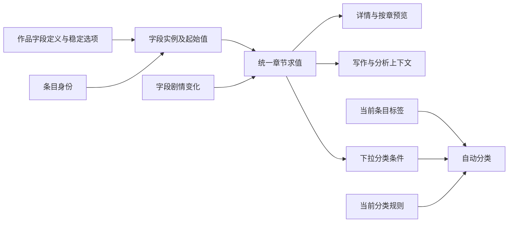

# 自定义设定字段与分类：总体设计

状态：2026-11-05 最终摘要后用户回复“开始”，设计已批准。需求以本任务 `prd.md` 为准；具体字段和分类合同分别由两个子任务的 `design.md` 持有。

## 1. 交付边界

采用父任务协调、两个子任务顺序实施：

1. `11-05-typed-setting-fields`：作品字段定义、四类型值、章初／章末回溯、旧字段兼容、详情控件、AI 及字段备份／卡片。
2. `11-05-setting-auto-categories`：当前整理标签、按标签或下拉规则自动分类、当前／章节视图及分类备份。

分类依赖字段的共享定义和按时点求值，必须在子任务 1 的接口与行为验证稳定后实施。父任务只维护总体要求和跨子任务验收，不抢占子任务的产品代码所有权。

## 2. 单一事实来源

- 扩展现有 `setting_timelines`／`setting_text_fields`／`setting_progressions`，保留旧字段 ID、事件 ID、章锚、事件顺序与修订号。
- `SettingProgression.value` 已是 JSON，存储不是重建事件系统的理由；需移除自定义值只能是文本的代码假定。
- 引入作品级字段定义和稳定下拉选项；旧字段保持条目内定义，作者可显式关联同类型共享定义，不按同名自动合并。
- 组织和职业定义增加独立主体，不能复用人物职业挂接 `career` 或组织成员 `membership`。
- 分类不保存成员副本；读取时使用同一个有效字段投影和当前标签计算，不能由前端另造求值器。

## 3. 共享产品合同

### 类型与位置

- 字段适用类型为角色、世界观六子类型、组织、职业。设定引用目标是这些现有条目；不新增任意实体类型。
- 四类字段均有起始值和章节变化。多行支持追加与替换，其他三类仅替换；空文本或显式空选项／空引用用于清空，PATCH 省略表示不变。
- 当前视图应用全部有效事件；指定位置沿用已有／计划章、章初／章末、孤立事件和章节改号规则。
- 字段名称、选项名称、条目名称、标签及规则是当前编辑元数据；不新增它们的名称或规则时间线。

### 归类

- 分类有适用条目类型、条件列表及 `all | any` 匹配方式；条件是单个标签或共享下拉字段的稳定选项。
- 默认当前，支持指定章节及章初／章末。下拉按该位置有效值匹配；标签按当前整理标签匹配，UI 显示这个口径。
- 同条目可以命中多个分类；删除分类不删除条目或字段。
- 分类与标签用于整理，不自动注入 AI、改变选角、授职或成员关系。

### 引用和历史保护

- 引用的值是目标身份；先回放来源字段，再格式化其在目标时点选中的身份。
- 引用展示目标的当前名称及类型，不递归加入目标正文、字段、关联对象或未来资料。
- 用轻量稳定引用句柄与真实实体外键保护身份，避免目标删除后裸整数 ID 被复用。服务给出明确 409；数据库外键作为遗漏入口的防线。完整作品删除仍应正常级联。
- 已使用的定义类型不原地转换；被值、事件或规则引用的选项／字段不能硬删。停用保留历史，停用不等于丢弃已保存资料。

## 4. 层与接口边界

| 层 | 责任 |
| --- | --- |
| Schema／codec | 有判别字段的值模型、合法清空、位置、正整数 ID 和规则结构；从边界一次规范化。 |
| 领域服务 | 归属、权限、适用类型、选项／引用合法性、版本比较及跨历史保护。 |
| 求值器 | 纯函数计算；不得查询 ORM、提交事务或递归注入引用资料。 |
| 格式器／查询服务 | 批量预取定义、选项和目标名称，统一格式化，避免每字段或每分类发一次查询。 |
| API | 沿用 `src/api` 对应的后端路由分层、snake_case 与 `{detail, code?}` 错误风格；路由不直接 ORM。 |
| UI | 独立字段配置、条目字段／变化、标签与分类；保留草稿、身份与请求代次，复用既有详情和导航。 |

保留旧文本接口的输入／输出语义。新类型通过新增类型化字段与新入口暴露，不能把对象塞进旧 `dict[int, str]` 返回值。旧接口不得通过修改一个绑定值而改掉全作品的字段定义。

## 5. 事务、并发和权限

- 新增／更新／删除在已有项目写屏障下完成；底层 helper 只 flush，外层 API 或任务负责 commit。
- 时间线值与事件沿用 timeline revision；共享配置额外持作品字段目录版本。分类规则与标签也有独立明确的 CAS 边界，不复用规划矩阵版本。
- 字段求值／分类查询是只读操作，不能为了显示空字段而创建绑定或时间线。
- 旧实体删除、世界观类型调整、向导覆盖、智能体效果和导入必须经过相同的保护原语；不能只检查新表单。
- 延用现有人工内容管理权限、只读与回收站屏障，不增加统一 AI 策略权限或管理其他作者模型的能力。

## 6. 迁移、导入与卡片

按子任务顺序冻结版本，避免同一版本被后续任务重新解释：

| 交付 | Alembic 计划 | 作品备份 | 卡片 |
| --- | --- | --- | --- |
| 当前 | `0034` | v3 | v3 |
| 字段 | `0035`，实施前再核对 head | v4，保留导入 v1–v3 | v4，支持类型化最新快照与显式引用映射 |
| 分类 | `0036`，依赖字段迁移 | v5，保留导入 v1–v4 | v5，保留所含条目标签，作品分类规则不混入单条卡片 |

- 新表和 JSON 内 ID 登记到项目注册表、语义 remapper、预览校验和智能体效果；引用句柄不能按普通整数或名称重映射。
- 完整备份携带全部起始值与历史；卡片保持快照用途，不跨作品复制章锚。
- 卡片内可映射引用按包内身份处理；包外引用必须在预览中列出并由用户显式映射，未解决时整笔拒绝，绝不猜测同名条目或静默置空。
- 降级不能无损表达新字段和历史引用；升级前保存完整备份。存在新增类型／主体／引用时，降级明确拒绝或要求恢复旧版本备份，不能伪装为无损回退。

## 7. 集成风险与验证

主要风险为旧文本假定、职业身份混淆、历史中才使用的引用、旧删除入口、卡片缺目标以及智能体撤销回退目录版本。分别以纯求值测试、数据库／迁移测试、实际 FakeLLM 消息、往返备份、冲突测试及真实浏览器验证。

字段子任务通过后才能开始分类；父任务最终复核四类字段在第 5／20／21 章的值、分类成员、上下文与恢复结果一致。详细命令和完成门禁见 `implement.md`。
