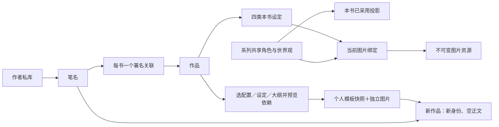

# 第 13 项总体技术设计

## 状态与设计入口

三项核心范围D13.1–D13.3及整体方案已由用户批准。总任务已进入实施；产品实现及验证结果以各阶段记录为准。

| 领域 | 权威设计 | 主要证据 |
| --- | --- | --- |
| 笔名 | `../11-16-pen-name-groups/design.md` | `research/pen-name-design-evidence.md` |
| 缩略图 | `../11-16-setting-thumbnails/design.md` | `research/thumbnail-design-evidence.md` |
| 模板 | `../11-16-novel-templates/design.md` | `research/template-design-evidence.md` |

## 总体边界

- 笔名是作者的私人库；作品关联只负责当前署名，不能授予笔名库访问权或取代真实账户。
- 缩略图是实体的展示附件，采用不可变资源与当前绑定，复用既有设定／系列权限；不进入剧情时间线、AI输入或正文。
- 小说模板是用户级的独立快照库，只能建立新作品；它消费本人笔名选择与规范化图片复制能力，不持有来源作品／系列的活跃绑定。
- 保留现有FastAPI service分层、SQLAlchemy事务、React API客户端／身份代次及AntD组件模式，不引入对象存储或额外进程。

## 数据模型与生命周期

| 数据 | 归属和生命周期 | 迁移／备份规则 |
| --- | --- | --- |
| PenName | User私有；删号合法时CASCADE | 纯用户表，整库保存；单书只保存当前署名文本。 |
| ProjectPenName | Project单行关联，两个复合FK确保同作者 | 删笔名只解除关联；回收站保留；单书NOT_EXPORTED。 |
| SettingImageResource | Project或Series恰好一个归属，UUID不可变 | 换图／删设定后保留历史资源；所属项目／系列硬删才清理。 |
| SettingThumbnailBinding | 四个本地主体之一或共享条目，真实FK | 当前图；本地小行进入Agent effects，资源bytes不进入。 |
| NovelTemplate／Image | User私有快照及自己的标准图 | 来源删除不影响；模板删除不删已建作品；只随整库保存。 |
| TemplateCreationReceipt | User隔离成功意图，结果Project SET NULL | 单书NOT_EXPORTED；不因模板／结果删除失去成功事实，不设会重复建书的TTL。 |

不将用户级私库误登记为项目备份表。图片表和创建收据分别因Project引用进入反射集合，按专用导出或运行态理由明确排除通用RULES。

## 组合契约

### 当前档案、模板与新书

模板保存当前人工可见档案值，包括当前页面已经投影的planned变化；新书把这些值作为confirmed初始设定，不重放旧章节或旧演变。预览明确描述语义。

所选条目引用了未选对象时列出原因并要求显式补选；不靠名称匹配，不静默置空或复制整张关系网。人物关系／成员仅在两端均已选中时保留，省略计数可见；实际需要的关系类型随快照冻结，按局部ref重建并保持方向。章纲带细纲但不直接创建章节／场景。

模板快照、来源、新书各自独立，尤其图片必须复制bytes到新归属。默认风格在建书时恢复快照内容，之后仍遵循原风格库共享编辑语义；不声称新增项目专属风格。

### 署名与协作

作品输出提供当前笔名名称；作者才有库ID和选择能力。协作者只能随已获授权作品读取当前名称。管理员人工内容权限不扩大到笔名或模板私库。开放EPUB沿已有授权使用当前作品署名，不新增私人库的开放API。

模板新建要求新的书名，笔名为创建者当次选择。所有新建入口继续参加既有User屏障和作品额度，回收站仍占额度。

### 图片与共享设定

本书独立四类设定可各自编辑图片；系列共享角色／世界观以canonical条目图片为权威。仅有书内权限者读本书投影图，不因此获得系列身份。修改共享图片必须走系列锁序，推进series.revision。

提升复制图至系列；采用读取canonical；退出／取消采用保留现有删除投影语义；移回复制至本书。单书备份和模板将共享图转为独立图，不保留系列绑定。

为保持撤销，旧标准图保留至项目／系列永久删除；这增加数据库和整库备份体积。单书备份／卡片／模板仅包含当前图，没有图库或历史图浏览能力。

## 并发与事务统一原则

- 所有修改先使用原actor认证与既有授权／User屏障，再取业务锁；内部无提交helper不能反向取得gate。
- 笔名库／关联与新建通过owner User串行；关联有项目锁和DB同作者约束。
- 系列保持Series→排序项目锁，不能Project→Series；图片解码在长事务外，写前重新鉴权。
- 模板预览使用一致读快照，保存确认以内容指纹和原actor复验；最终源项目锁内重新形成快照。
- 模板建书只在一笔事务中完成所有实体、配置、图片、笔名和成功收据，失败整体回滚。不可串接现有会各自commit的卡片／大纲／普通建书入口。
- 幂等重放先普通读receipt再锁结果Project，不先锁receipt，避免与系统purge的Project→receipt SET NULL死锁。
- 模板ID删除后不得复用；SQLite显式AUTOINCREMENT、PG sequence以及应用禁用旧ID分配共同保护旧页面请求，不以revision从1重置代替对象身份。
- 图片效果仅捕获绑定小行；撤销验证资源同作用域及当前共享归属，不用已被复用的整数身份恢复其他图。

## 兼容与版本安排

| 阶段 | 单书备份 | 其他格式 | 兼容策略 |
| --- | --- | --- | --- |
| 当前基线 | v9 | 设定卡v6、effects v6 | 调查时APP_SCHEMA仍为0052，但磁盘迁移到0054；实施重新核对。 |
| 笔名完成 | v10 | 其他不变 | 新增当前pen_name文本，兼容读v1–v9。 |
| 缩略图完成 | v11 | 设定卡v7、effects v7 | 新增当前thumbnails，兼容读v1–v10；卡v1–v6和旧effects保留合法路径。 |
| 模板完成 | v11 | 模板内部v1 | 不把模板库混入单书文件；更新实际APP_SCHEMA。 |

每阶段迁移由对应子任务分配，依当前真实head顺序创建，不预占数字。版本常量只有一个权威位置，完成一个阶段再进入下一个。旧应用应拒绝未来格式，不能静默忽略笔名／图片。

图片输入≤10MiB／16MP／8192边，标准WebP最长512px、≤512KiB；卡紧凑JSON总上限16MiB，作品备份沿用100MiB总上限。模板JSON≤10MiB、图片累计≤50MiB，选择图／章纲／细纲上限详见模板设计。所有估算包含图片base64，超限清楚报错而不丢数据。

## 前端与文件所有权

三个子任务顺序接入共享的模型注册、API types、ProjectList／CreateProjectModal、registry／importer／exporter和迁移测试。即使子代理负责不同层，也不能在未协调时同时改这些文件。

前端优先复用局部状态和已有scope guard；新增私有资源请求必须按actor／请求代次失效。笔名和图片独立保存只合并自己的metadata，不覆盖脏文本。模板库懒加载，新建模板成功打开概览，原空白建书进入向导的行为保持。

## 技术风险与部署回退

| 风险 | 控制与验收 |
| --- | --- |
| 类型引用／同名实体／当前值复制错误 | 严格局部ref与显式闭包，四实体×字段类型和planned投影测试。 |
| 多服务提前commit导致半本书 | 无提交bootstrap、最后阶段失败注入、真实事务回滚。 |
| 系列和图片撤销冲突 | 既有锁序、图片归属FK、effects共享预检及真实PG竞争。 |
| 大图／大量快照占资源 | 完整解码和有界线程、图数／字节上限、metadata估算，列表不读bytes。 |
| 新库打包差异 | 实施中验证Python3.12和部署容器的Pillow／WebP功能。 |
| 新字段／私库越权 | 最终授权投影、owner-only管理、账号切换／撤权测试及开放API显式schema。 |
| 数据回滚丢失 | 有新增数据或成功收据时拒绝有损downgrade；先退应用入口，保留兼容表。 |

不在规划阶段运行迁移、安装新依赖或修改生产数据。本任务不包含线上部署；质量验证、文档和用户后续明确的发布操作分别记录。
