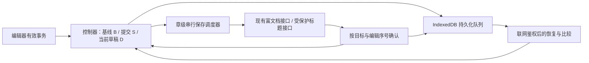

# 自动保存与异常草稿恢复：技术设计

用户已批准实施方案 A。本文记录目标行为与实施约束，验证结果单独记录。

## 1. 范围与方案选择

- 用户已确认：页面打开后断网仍可写作并保留本地草稿；联网重新打开、完成身份与作品访问校验后恢复。不提供离线启动或离线登录。
- 自动同步范围为**章节标题与当前场景完整正文文档**。文档内格式、作者区块和标记属于正文语义，必须一并保护。独立场景标题／摘要继续手动保存，但同一控制器内的未保存字段随本地快照保留，不能被自动保存回调清掉。
- 一个 Trellis 任务按阶段实施。服务端前置条件、编辑器在途状态、本地恢复和 UI 共同构成一次端到端验收，不拆成可独立发布的子任务。
- 生产运行时采用原生 IndexedDB 和现有 API／组件；测试新增开发依赖 `fake-indexeddb`。不新增数据库草稿表、内容修订号列、后台同步服务或运行时状态框架。
- 标题选择“原值条件比较 + 稳定场景锚点 + 单调章内容版本”，复用现有事务锁；实际标题变更也推进已有 `content_revision`，不新增 `title_revision`。单调版本用于阻止标题 A→B→A 后旧请求重新生效。

相关证据：`research/current-state.md`、`research/backend-save-contract.md`、`research/editor-state-contract.md`、`research/browser-persistence.md`。

## 2. 所有权与数据流

`SceneDraftController` 仍是场景编辑状态的唯一所有者；章标题的草稿状态提取为可测试控制器。调度器负责时机、串行写入与动作屏障，不维护另一份可编辑正文。持久化仓库只存不可变快照；服务端 Scene／RichDocument 仍是已保存正文权威，Chapter.content 仍是兼容投影。



核心不变量：

1. 服务端确认只推进其实际提交的快照，不替换之后的新输入。
2. 一章一个编辑实例至多有一个服务器写入链；同章其他标签页／设备由服务端条件写保护。
3. 不通过更新本地版本号、重放旧请求或关闭富文档校验消除冲突。
4. 本地持久化成功、服务端同步成功和完整编辑器全部字段已保存是三个不同事实。
5. 内容、标题与独立摘要分别记账；正文成功而标题失败不回退正文，也不重发已确认正文。
6. 加载、撤权清空、状态发布、服务端回填不是作者输入事件，不得产生新空草稿。

## 3. 保存触发与交互

| 场景 | 规则 |
| --- | --- |
| 普通输入／格式编辑 | 最后一次有效编辑后 1500 ms 自动保存；持续输入时最长等待 10 s 发起一次快照保存。参数集中定义并用 fake timers 验证。 |
| 中文组合输入 | 组合未提交时不发服务器写请求；保留上一份完整草稿，compositionend 后按最新有效文档调度。 |
| 保存请求在途 | 正常文字、格式和标记编辑继续有效；新编辑成为下一份快照。仅禁止会替换目标或正文权威的动作。 |
| 手动保存／Ctrl/Cmd+S | 合并到同一串行通道，立即 flush 最新已提交输入及原有手动字段，不重复并发发送。 |
| 已知离线、请求尚未发出 | 持续保存本地，暂停服务器写入；重连后校验当前身份、权限和基线，相同才恢复调度。 |
| 已发送请求结果未知 | 暂停自动同步；读取最新快照核对。展示“核对并重试”，不以定时退避无限重放写请求。 |
| 409、恢复待选择、无法验证结构 | 保留本地草稿并暂停该目标自动同步，等待作者处理。 |

页头状态由结构化状态计算，避免互斥布尔值拼文案：

- 本地状态：保留中／已保留至某次编辑／保留失败。
- 同步状态：待保存／保存中／已保存／离线待同步／保存失败／待核对／权限受限。
- “已保存”仅在所有纳入该次保存的最新字段均确认后出现；独立摘要仍 dirty 时保留其单独未保存提示。
- 自动保存成功不弹 toast；错误以持续状态及操作入口展示，手动动作沿用既有反馈。

## 4. IndexedDB 记录与事务契约

数据库名建议 `ainovel.editor-drafts`，初版 DB version 和记录 `schema_version` 均为 1。单个 `drafts` store 以随机 `draft_id` 为主键；按账号／作品及章目标建立索引。仓库接口接受注入的 IDBFactory、时钟和 ID 生成器，生产用浏览器实现，测试逐例隔离。

### 4.1 记录模型

| 字段组 | 内容 |
| --- | --- |
| 身份 | `draft_id`、`writer_id`；actor 的 ID 与 created_at；project 的 ID 与 created_at；chapter_id；稳定 `anchor_scene_id`。场景草稿另含 scene_id 与 created_at。 |
| 目标 | 判别联合 `chapter_title` 或 `scene_document`。标题单独保存，不复制到每个场景草稿里。 |
| 顺序 | `schema_version`、单调 `record_seq`、输入序号 `edit_seq`、`saved_at`；record_seq 对 B/S/D、证据、attempt 阶段或恢复暂停状态的每次持久变化都递增，edit_seq 只随有效输入递增。时间仅用于展示。 |
| 基线 B | 服务器基线标题与条件、章内容版本；或场景基线、完整 RichDocument 和规划版本。 |
| 当前 D | 标题或完整 RichDocument；场景标题／摘要作为独立手动字段及 dirty 信息保留。 |
| 证据 | B→D 的映射、显式增删／恢复、已退场身份；存在提交 S 时拆为 B→S 与 S→D 两段。 |
| 在途 S | 本地 attempt ID、冻结请求值／条件／编辑序号、当前步骤和各字段确认情况；不保存 token、cookie 或可复用授权凭据。 |
| 恢复状态 | `recovery_hold`、来源 `draft_id + record_seq`，恢复后是否已由作者允许同步；该状态随刷新保留，不以失去内存状态当作同意。 |

原场景 ID 为防止章节 ID 复用的重要锚点；章 `created_at` 即便暴露也不能代替它，SQLite 同秒删除／重建可能复用 ID 与时间。首次读取、恢复安装和标题写入均核对该锚点确实属于目标章。锚点已退场时进入目标失效流程，不自行改绑到目录第一景。整体数据库回档／切换并复用历史 ID 不属于本期自动识别保证范围。

`writer_id` 每个页面运行实例重新生成，不复用可能被复制标签页继承的 sessionStorage ID；每个目标生成独立草稿分支。刷新后的旧分支进入候选列表，不直接接管其他标签页写入槽。

### 4.2 写入、清理与故障

- 首次有效编辑立即提交本地写队列；一个本地事务在途时只合并一个待写的最新快照，完成后立即提交它，避免持续输入使尾部防抖永久不触发。
- 每个分支串行，事务内检查 `record_seq` 单调。只有事务 `complete` 才报告该快照本地已保留；同一 edit_seq 的旧 ACK／新 attempt 也由 record_seq 区分，单条 request 的 `success` 不够。
- 发服务器请求前，先尝试把冻结 S 及阶段写入本地。存储不可用时仍允许既有服务器保存，持续显示本地保护失败；恢复时缺少可靠 S 则按旧 B 与当前服务器比较，冲突时禁止自动重发。
- 网络 ACK 只经控制器验证当前 attempt ID／阶段／身份后产生完整的新快照并递增 record_seq，不直接局部修改仓库基线。仓库拒绝过时 record_seq，已确认／替代 attempt 的迟到回调不能重启或回退状态。
- 成功清理使用同一事务中的 `draft_id + writer_id + record_seq` 条件，且所有字段含独立摘要均 clean、没有未确认 attempt 或 recovery_hold 才可删；有新序号就保留。删除后旧排队写入须由已关闭分支代次拦截，不能复活记录。不得按章节或账号批量清空。
- 恢复时先事务性建立新分支，默认保留来源；来源修改后保留新版，不能因恢复副本已同步删除来源。作者明确舍弃来源时按看到的 record_seq 条件删除，变化则重新比较。其他标签页原分支永不被网络 ACK 顺带清掉。
- 未同步记录不设置自动过期删除，不用静默淘汰未同步草稿解决配额。已同步记录和作者明确舍弃的精确版本可清理。
- `blocked`、`versionchange`、意外 close、abort、QuotaExceededError 均进入可见错误状态并保留上一份成功记录；不通过清库恢复可用性。
- 尽可能使用标准 `durability: 'strict'`；不支持时使用标准默认事务。`visibilitychange`／`pagehide` 只催促队列，不依赖关闭事件完成最后写入。
- 记录从 `unknown` 解码：验证模式、身份、数字范围、文档结构与证据引用。未知模式或损坏记录不自动导入、不覆盖、不删除；允许显式导出原始记录或舍弃。

草稿恢复保证以最后一次成功保留的有效编辑为边界；浏览器清除站点数据、尚未提交的输入法候选文字及尚未完成的本地事务不宣称可恢复。重新打开建立新的编辑撤销起点，不持久化整个 PM 撤销栈。

## 5. 保存期间继续输入：B / S / D 算法

每个字段组持有 `base` B、当前 `draft` D、单调 `editSeq`、至多一个不可变 `attempt` S。S 绑定 actor／会话／授权代次、project／chapter／scene、请求代次、预期服务器版本、提交字段与完整证据。

1. 调度器从控制器取得一致快照，冻结 S；后续输入只改变 D，并独立累积 S→D 的有效编辑证据。
2. 成功响应先检查身份、目标、代次和响应是否精确对应 S；只推进 B 和本次字段确认，服务器派生数据由响应更新。
3. D 等于 S 的相应字段时该字段变为 clean；D 已变化则保留 D，重新基于新 B 计算下一次请求。不能通过 `setTitle(response.title)` 或完整 document prop 回填抹掉尾部输入。
4. 确定未提交的失败将 B→S 与 S→D 证据重新组成 B→D；未知结果保留两段并停止自动写入，直到核对。
5. 文档、元数据和章标题分步骤确认；若文档已确认，后续 GET／标题请求失败也不能撤回它的基线。自动模式不附带提交独立场景标题／摘要。

### 5.1 富文档证据重定位

复用现有真实 ProseMirror 事务所生成的映射和历史意图，提取纯函数负责冻结、累积和基线推进；不能从 UUID 相等或纯文字相等猜测映射。

- S 新建区块、D 在请求期间删除它：S 成功后该身份已存在于服务端，D 需要补退场身份，下一次是删除，不是忽略。
- S 删除区块／标记、D 在请求期间撤销：确认后下次请求必须使用经真实历史事务证明的 `restore_*_keys`，不能冒充新建。
- S 保存文字、D 后续移动区块或标记：保留尾部映射，已发送证据成功后只清理已确认部分。
- 复用 `historyRetiredSections` 和受校验的 `rich-section-history-sync` 事务同步墓碑，使用 `addToHistory=false`；只变基线／墓碑时不能调用 `EditorState.create` 清空用户撤销栈。
- 组合输入期间收到 ACK，推迟会扰动编辑器的元数据同步，组合提交仍属于尾部；不得丢弃它或伪造完成输入。

这些竞态是实施阶段的先行验证点。未通过控制器及真实 PM 历史测试前，不接通自动保存 UI。

## 6. 服务端标题保存契约

### 6.1 新入口

新增 `PATCH /projects/{project_id}/chapters/{chapter_id}/editor-title`，返回现有 `ChapterOut`。请求严格限定四个必填字段：

```json
{
  "title": "新的标题",
  "expected_title": "本次编辑基于的服务器原始标题",
  "expected_scene_id": 123,
  "expected_content_revision": 17
}
```

- `title` 沿用现有 200 字限制与 trim 规则；`expected_title` 允许空串且不 trim，按读取时服务器原值精确比较。
- `expected_scene_id` 是该标题分支原始场景锚点，正整数；`expected_content_revision` 非负严格整数。
- 路由负责声明请求模型，权限、目标读取、锁、条件判断及写入仍在 service。复用人工 `content.edit`、项目／章写屏障、生成中门禁和审计提交；不得另开无鉴权的自动保存路径。
- 编辑器的标题、文档 PUT 与场景元数据 PATCH 携带 `X-Editor-Actor-Id` 与 `X-Editor-Actor-Created-At`。服务端比对本次已认证的账号，并在写锁内授权读取时再次核对账号创建时间，避免 SQLite 复用数字 ID。身份变化返回 409 `editor_actor_changed` 并拒绝写入。旧客户端仍沿用原鉴权协议；两项条件均不赋予权限。
- 锁内先验证场景锚点属于当前章且活动，再检查内容版本和原始标题，全部满足才修改。即使现值等于欲保存标题，前置条件不符仍拒绝；前端另用 GET 核对“目标已一致”。
- 实际标题变化通过 `scene_service.touch_revision` 原子推进已有章内容修订号，并继续推进规划版本和记录审计；标题-only 不新增正文历史。未变化的标题不发请求；条件匹配的同值 no-op 不推进版本。
- `expected_title`、`expected_scene_id` 与 `expected_content_revision` 都是协议条件，须从 `audit.track` 模型字段集合排除，不把它们作为 Chapter 属性记录。
- 若本实例先成功保存正文，标题步骤可使用本次已确认的新内容版本；`expected_title` 仍是标题原基线，不能从后来 GET 静默替换。

标题成功返回的新 content_revision 也更新本实例当前场景的已确认版本基线，但不替换 D 或清空映射证据；这是已证明只修改标题的自有提交。先验证期望的单调推进，再刷新需要的 planning_revision；AI／恢复操作必须在最新规划快照核对后进行。任意额外版本变化仍进入冲突，不以自有提交为由接受其他端变化。

### 6.2 旧入口与内部调用

原 `PATCH /chapters/{id}` 的 HTTP 标题更新同步要求相同三项前置条件，缺失返回 422；不涉及标题的旧请求维持原语义。使用独立 HTTP 请求校验边界，不把这个要求强加到内部 Agent 的模型参数上。

不能以 `manual=True` 判断请求一定来自 HTTP：协作者 Agent 也可能使用人工权限路径。条件齐备要求放在两个人工 HTTP 请求模型中，实际条件比较仍由共享 service 在锁内完成。

内部 Agent 保留既有锁内完整预览比对后调用 service 的契约；调查列明所有实际调用点，修改只覆盖真实人工标题写入及共享 guard，不让新字段绕过 Agent 审批或扩张权限。

所有实际章标题修改都必须保持内容版本单调，包括共享 `chapter_service.update_chapter` 内的 Agent 执行和 `agent/effects.py` 的纯标题撤销。effects 已排除旧 content_revision 回灌，需把实际改变标题的章纳入其现有投影／版本刷新集合；同批正文或场景路径已推进时去重。混合 title+content PATCH 先校验共同原版本，正文路径已推进则不因标题再冲突或多 bump；只有标题真实变化而正文路径未推进时额外推进一次。

兼容性取舍：标题修改会使同章其他草稿和 AI 内容快照更保守地失效；这是阻止迟到请求 ABA 的必要保护。不能只加 expected_title 而保留不推进版本的旧标题写入，也不能通过新增独立列但漏改撤销路径来宣称单调。

新前端标题只调用 `/editor-title`，不 fallback 到旧裸写。旧后端没有此路由时 404 可见失败；这也防止页面打开后后端回滚，旧 schema 忽略额外字段而意外无条件写入。

### 6.3 错误语义

| 条件 | 响应／客户端处理 |
| --- | --- |
| 缺字段、null／类型非法、非法长度 | 422；保留草稿并修正输入，不盲重试。 |
| 未登录或失去权限 | 401／403／既有隐藏式 404；重新校验并按原权限规则隐藏／冻结，草稿不被空值覆盖。 |
| 场景锚点失效 | 409 `editor_target_changed`；原草稿保留，重新比较目标，不改绑第一景。 |
| 内容版本过期 | 409，沿用 `stale_scene_revision` 语义。 |
| 标题原值不匹配 | 409 `stale_chapter_title`；通过受控 GET 读取当前版本比较。 |
| 生成中／写入门禁冲突 | 沿用现有 409 语义，待任务状态核对后再操作。 |
| 超时、断网、5xx 或异常响应 | 结果未知；保留 S，通过最新读取核对，不能报告失败即未提交。 |

## 7. 恢复与未知结果分类

恢复入口先验证当前账号和作品访问，再按目标读取章、场景、完整文档的一致快照。服务器读取失败时可提示本机存在草稿，但不绕过身份校验显示正文。账号／作品不存在或无读取权限时不展示其本地内容。

列出各分支的目标、保存时间、字数和恢复状态；时间仅供作者选择，不自动挑时间最新者覆盖其他分支。选中“恢复到编辑区”只安装草稿，不直接发请求；正常基线下由“保存恢复稿”或恢复后的自动保存字段新编辑进入调度，冲突状态必须先明确处理。

安装恢复稿也是替换编辑区的动作：先排空／核对该实例的在途写入，并成功持久化当前 D 为独立副本；本地存储失败时保留当前编辑区，只有作者明确舍弃当前输入后才可替换。来源记录复制安全不能代替保护被替换的当前 D。

恢复产生持久 `recovery_hold`。只有作者点击“保存恢复稿”或在恢复目标的自动保存字段进行新编辑且基线已核对，才能解除；重连、刷新、仅修改独立摘要或后台发布事件不得自动解除。其他待恢复分支继续保留，无自动清理。

已发出的保存请求收到 401／403／404 时，也不能认定事务没有提交：现有端点在 commit 后还有响应投影与读权限检查。保留 S 并冻结／隐藏，恢复合法访问后再核对；不能仅沿用 `writeResultUnknown` 对状态码的旧分类回退基线。只有可证明发生在提交前的校验／冲突失败，才归并回未发送基线。

| 核对结果 | 行为 |
| --- | --- |
| 没有遗留 S，服务器完整值及版本等于 B | 安装 D 与原证据，可按上述显式动作恢复同步。 |
| 遗留 S 与服务器完整值、目标及本步骤预期版本吻合 | 确认目标状态已一致，推进对应字段的 B；保留 D 的尾部；不能声称整份最新草稿都已保存。 |
| 遗留 S，但服务器仍与 B 完全一致 | 原请求仍可能迟到。显式重试生成带原条件的新请求，由服务器 CAS 保证不会双重覆盖；不撤销旧请求后立即无条件重发。 |
| 服务器版本更高、与 B/S 不同，或结构证据不足 | 进入冲突；保留 B/S/D，停止自动写入。全文相同也不能忽略格式、区块和标记变化。 |
| 场景退场／章节已删除／锚点不匹配 | 显示目标失效；可查看／导出或舍弃，禁止套用到相邻或重建目标。 |

当遗留 S 结果未知且远端仍是 B 时，GET 不能证明旧请求已经结束。此时“采用服务器版本”“舍弃并结束核对”和 AI／恢复等改变权威的动作继续禁用；允许保留副本、继续本地编辑、核对，或明确重试原 S。只有请求已明确结束且未提交，或原预期修订号已被一次确认写入不可逆消耗后，才能结束这段未知状态。标题重试及随后恢复旧标题也推进单调版本，所以旧 S 不能在 A→B→A 后重新获得写入资格。纯同值 no-op 不算消耗条件。

为防止失效目标草稿无法到达，在作品章节列表提供“本地草稿”入口；编辑页提供当前章快捷入口。两者复用同一恢复面板，只列当前账号且当前可读作品的记录，不新增全站草稿管理页。

## 8. 冲突比较与保留选择

扩展现有 `SceneConflictReview`，复用 `TextDiff`：分别显示章标题、正文、按稳定 key 的区块增删／标题／文字变化，以及格式和标记归属／状态差异。确认绑定本地 `draft_id + editSeq` 和远端版本；任何一边变化后重置确认。

- **保留本地并同步**：仅在现有结构／身份／映射条件能够证明安全时，作者确认后以最新已核对基线构造新请求，提交时仍校验服务器条件。
- **采用服务器版本**：安装服务器版本，先保留原本地分支为可恢复副本；只有作者另行明确舍弃才删除对应版本。
- **暂不处理**：可继续保留本地编辑，暂停服务器自动同步。
- **结构不能安全复用**：保持现有拒绝旧结构覆盖的保护，提供完整只读对比、复制文本和完整草稿 JSON 下载。可采用服务器版本后人工整理；本期不实现通用富文档三方合并或强制结构覆盖协议。

导出只包含当前获准查看的所选草稿，不含会话凭据；优先复用现有下载工具。JSON 是保留／检查用格式，首版不增加任意 JSON 导入接口。仅复制纯文本时说明不包含格式、区块和标记，不能宣称完整恢复。

## 9. AI、恢复、导航与权限屏障

- `ensureSaved` 改为读取最新控制器并 `flushThroughCurrentEdit`，不依赖过期闭包 dirty。AI／版本恢复／结构变更等显式动作先建立短暂动作屏障，排空当前保存，确认最新版本，再构造动作请求。
- 普通自动保存不锁输入；动作屏障仍允许现有 AI／局部提案／结构操作按各自规则锁定，不能因为拆分 saving 就放开危险控件。
- AI 完成、版本恢复、区块转换等改变正文权威时，使旧定时器与确认代次失效；有本地草稿时进入比较，无草稿时才安装新基线。
- 场景切换沿用成功保存后切换的规则；保存失败可通过明确离开操作退出，先尽力确认本地持久化，文案依据本地结果说明是否可恢复。笔记／排序／未采纳 AI 预览仍按原保护，不冒称已持久化。
- 登出、换账号、作品撤权使请求和 UI 代次失效，关闭订阅与定时器；旧请求最终成功也不能清除新身份记录。持久记录保留但隐藏，再登录后须重新鉴权。
- 跨标签页可变更同源会话 Cookie。恢复和导出前重新核对当前登录账号及作品权限，保存请求绑定作者 ID 和账号创建时间。不能单凭标签页内缓存或广播判断服务端当前身份。
- 网络错误本身不当作明确撤权；复用项目 `confirmed/denied/unknown/stale` 核对语义，只有明确无权时按既有规则撤下内容。刷新权限期间不发服务器写入。
- BroadcastChannel 只发送目标／序号／变化类型等元信息，促使同账号页面重读；不是互斥锁，正文与凭据不出现在广播中。不可用时靠 CAS 和恢复时读取保持正确。

## 10. 兼容、发布与回退

- 不改服务端数据库结构或作品备份版本；本地 IndexedDB 的版本独立于服务端 Alembic。
- 后端保护路由及旧入口 guard 先部署，再发布前端；旧缓存前端标题裸写被 422 拒绝并提示刷新，不能静默兼容为不安全写入。
- 回退前端保留后端 guard；回退到完全旧后端时，新前端 `/editor-title` 失败并留草稿，禁止 fallback。旧前端＋旧后端本身无本功能保证。
- 前端回退不主动清理新 IndexedDB；再次升级应能读取 schema 1，遇未来 schema 只能提示／导出，不能清库重建。
- 审计及日志不增加正文、草稿 JSON 或凭据；使用既有错误与动作审计路径，不为本任务增加运营报表。

## 11. 验证与剩余风险

先验证标题条件写与富文档在途编辑证据，再接通持久化和 UI。测试细节、顺序及 A1–A12 映射见 `implement.md`。

- 浏览器真实持久化、双页、关闭重开、IME 和撤销栈必须验收；内存 fake IndexedDB 不能证明磁盘持久化或配额行为。
- 富文档结构冲突保留完整草稿，但不保证所有冲突均可一键采用本地全文；这是首版沿用的安全边界。
- 后端按当前 README／CI 执行 SQLite 门禁；仓库已移除 PostgreSQL 测试资产，不把过时 spec 中的 PG 命令写为必需步骤，也不宣称 PG 并发已实测。
- 连续输入的大文档需检查本地队列只保留一个待写快照、无无界历史证据增长；冻结快照不可变，必要时按成功提交推进基线，不能截断用户内容减负。
- 文档评审通过只是进入实现的条件，不是这些验收已通过。
